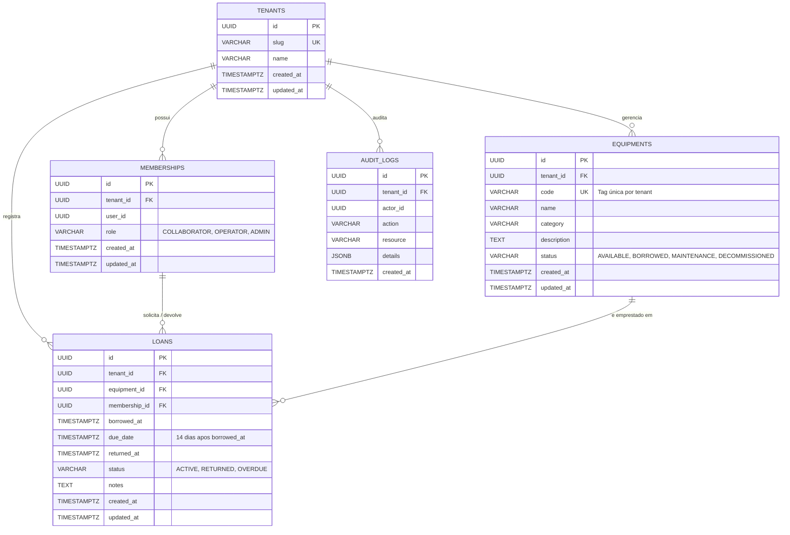

# SPEC 001 — Modelagem de Dados e Schema do Banco

- **Status:** Draft
- **Data:** 2026-10-01
- **Autor:** Agente / Operações
- **Objetivo:** Definir a modelagem lógica e física (PostgreSQL/Prisma) do banco de dados para suportar o fluxo de empréstimo e devolução de equipamentos internos com isolamento multi-tenant e auditoria.

---

## 1. Contexto e Requisitos (PRD & ADR-001)

- **Multi-tenancy:** Isolamento lógico por `tenant_id` em todas as tabelas de domínio.
- **Autenticação:** Usuários autenticados pelo Supabase Auth (`user_id` correspondente a `auth.users`). Vínculo usuário-tenant via tabela `memberships`.
- **Equipamentos:** Controle de catálogo, patrimônio único (`code`) e status (`AVAILABLE`, `BORROWED`, `MAINTENANCE`, `DECOMMISSIONED`).
- **Empréstimos:** Controle de retiradas, prazo padrão de 14 dias, vínculo com usuário e equipamento, devolução no balcão.
- **Auditoria:** Registro append-only de ações no sistema com `tenant_id` e `actor_id`.
- **Segurança:** Row Level Security (RLS) habilitado em todas as tabelas.

---

## 2. Modelagem Lógica (MER)



---

## 3. Schema Prisma Proposto (`prisma/schema.prisma`)

```prisma
datasource db {
  provider  = "postgresql"
  url       = env("DATABASE_URL")
  directUrl = env("DIRECT_URL")
}

generator client {
  provider = "prisma-client-js"
}

model Tenant {
  id          String       @id @default(uuid())
  slug        String       @unique
  name        String
  createdAt   DateTime     @default(now()) @map("created_at")
  updatedAt   DateTime     @updatedAt @map("updated_at")

  memberships Membership[]
  equipments  Equipment[]
  loans       Loan[]
  auditLogs   AuditLog[]

  @@map("tenants")
}

enum Role {
  ADMIN
  OPERATOR
  COLLABORATOR
}

model Membership {
  id        String   @id @default(uuid())
  tenantId  String   @map("tenant_id")
  userId    String   @map("user_id")
  role      Role     @default(COLLABORATOR)
  createdAt DateTime @default(now()) @map("created_at")
  updatedAt DateTime @updatedAt @map("updated_at")

  tenant Tenant @relation(fields: [tenantId], references: [id], onDelete: Cascade)
  loans  Loan[]

  @@unique([tenantId, userId])
  @@index([userId])
  @@map("memberships")
}

enum EquipmentStatus {
  AVAILABLE
  BORROWED
  MAINTENANCE
  DECOMMISSIONED
}

model Equipment {
  id           String          @id @default(uuid())
  tenantId     String          @map("tenant_id")
  code         String
  name         String
  category     String
  description  String?
  status       EquipmentStatus @default(AVAILABLE)
  createdAt    DateTime        @default(now()) @map("created_at")
  updatedAt    DateTime        @updatedAt @map("updated_at")

  tenant Tenant @relation(fields: [tenantId], references: [id], onDelete: Cascade)
  loans  Loan[]

  @@unique([tenantId, code])
  @@index([tenantId, status])
  @@map("equipments")
}

enum LoanStatus {
  ACTIVE
  RETURNED
  OVERDUE
}

model Loan {
  id           String     @id @default(uuid())
  tenantId     String     @map("tenant_id")
  equipmentId  String     @map("equipment_id")
  membershipId String     @map("membership_id")

  borrowedAt   DateTime   @default(now()) @map("borrowed_at")
  dueDate      DateTime   @map("due_date")
  returnedAt   DateTime?  @map("returned_at")
  
  status       LoanStatus @default(ACTIVE)
  notes        String?

  createdAt    DateTime   @default(now()) @map("created_at")
  updatedAt    DateTime   @updatedAt @map("updated_at")

  tenant     Tenant     @relation(fields: [tenantId], references: [id], onDelete: Cascade)
  equipment  Equipment  @relation(fields: [equipmentId], references: [id], onDelete: Restrict)
  membership Membership @relation(fields: [membershipId], references: [id], onDelete: Restrict)

  @@index([tenantId, membershipId, status])
  @@index([tenantId, equipmentId])
  @@map("loans")
}

model AuditLog {
  id         String   @id @default(uuid())
  tenantId   String   @map("tenant_id")
  actorId    String   @map("actor_id")
  action     String
  resource   String
  details    Json?
  createdAt  DateTime @default(now()) @map("created_at")

  tenant Tenant @relation(fields: [tenantId], references: [id], onDelete: Cascade)

  @@index([tenantId, createdAt])
  @@map("audit_logs")
}
```

---

## 4. DDL SQL com RLS (Referência para Migrations)

```sql
CREATE EXTENSION IF NOT EXISTS "uuid-ossp";

-- Tabelas
CREATE TABLE tenants (
    id UUID PRIMARY KEY DEFAULT uuid_generate_v4(),
    slug VARCHAR(64) UNIQUE NOT NULL,
    name VARCHAR(255) NOT NULL,
    created_at TIMESTAMPTZ NOT NULL DEFAULT NOW(),
    updated_at TIMESTAMPTZ NOT NULL DEFAULT NOW()
);

CREATE TYPE membership_role AS ENUM ('COLLABORATOR', 'OPERATOR', 'ADMIN');

CREATE TABLE memberships (
    id UUID PRIMARY KEY DEFAULT uuid_generate_v4(),
    tenant_id UUID NOT NULL REFERENCES tenants(id) ON DELETE CASCADE,
    user_id UUID NOT NULL,
    role membership_role NOT NULL DEFAULT 'COLLABORATOR',
    created_at TIMESTAMPTZ NOT NULL DEFAULT NOW(),
    updated_at TIMESTAMPTZ NOT NULL DEFAULT NOW(),
    CONSTRAINT uq_memberships_tenant_user UNIQUE (tenant_id, user_id)
);

CREATE TYPE equipment_status AS ENUM ('AVAILABLE', 'BORROWED', 'MAINTENANCE', 'DECOMMISSIONED');

CREATE TABLE equipments (
    id UUID PRIMARY KEY DEFAULT uuid_generate_v4(),
    tenant_id UUID NOT NULL REFERENCES tenants(id) ON DELETE CASCADE,
    code VARCHAR(64) NOT NULL,
    name VARCHAR(255) NOT NULL,
    category VARCHAR(100) NOT NULL,
    description TEXT,
    status equipment_status NOT NULL DEFAULT 'AVAILABLE',
    created_at TIMESTAMPTZ NOT NULL DEFAULT NOW(),
    updated_at TIMESTAMPTZ NOT NULL DEFAULT NOW(),
    CONSTRAINT uq_equipments_tenant_code UNIQUE (tenant_id, code)
);

CREATE TYPE loan_status AS ENUM ('ACTIVE', 'RETURNED', 'OVERDUE');

CREATE TABLE loans (
    id UUID PRIMARY KEY DEFAULT uuid_generate_v4(),
    tenant_id UUID NOT NULL REFERENCES tenants(id) ON DELETE CASCADE,
    equipment_id UUID NOT NULL REFERENCES equipments(id) ON DELETE RESTRICT,
    membership_id UUID NOT NULL REFERENCES memberships(id) ON DELETE RESTRICT,
    borrowed_at TIMESTAMPTZ NOT NULL DEFAULT NOW(),
    due_date TIMESTAMPTZ NOT NULL,
    returned_at TIMESTAMPTZ,
    status loan_status NOT NULL DEFAULT 'ACTIVE',
    notes TEXT,
    created_at TIMESTAMPTZ NOT NULL DEFAULT NOW(),
    updated_at TIMESTAMPTZ NOT NULL DEFAULT NOW()
);

CREATE TABLE audit_logs (
    id UUID PRIMARY KEY DEFAULT uuid_generate_v4(),
    tenant_id UUID NOT NULL REFERENCES tenants(id) ON DELETE CASCADE,
    actor_id UUID NOT NULL,
    action VARCHAR(100) NOT NULL,
    resource VARCHAR(255) NOT NULL,
    details JSONB,
    created_at TIMESTAMPTZ NOT NULL DEFAULT NOW()
);

-- RLS Habilitado (Defesa em profundidade)
ALTER TABLE tenants ENABLE ROW LEVEL SECURITY;
ALTER TABLE memberships ENABLE ROW LEVEL SECURITY;
ALTER TABLE equipments ENABLE ROW LEVEL SECURITY;
ALTER TABLE loans ENABLE ROW LEVEL SECURITY;
ALTER TABLE audit_logs ENABLE ROW LEVEL SECURITY;
```

---

## 5. Plano de Implementação

1. **Passo 1:** Configurar o Prisma no `emprestai-back` criando `prisma/schema.prisma` com os modelos propostos.
2. **Passo 2:** Gerar a migration inicial via `npx prisma migrate dev --name init_schema`.
3. **Passo 3:** Adicionar as policies de RLS ao SQL gerado pela migration.
4. **Passo 4:** Criar o seed inicial (`prisma/seed.ts`) idempotente criando o tenant inicial `suporte_ti`.
5. **Passo 5:** Executar verificação com `npx prisma migrate reset` e validar integridade.

---

## 6. Critérios de Aceitação

- [ ] Todas as 5 tabelas (`tenants`, `memberships`, `equipments`, `loans`, `audit_logs`) criadas com chave primária UUID e `tenant_id`.
- [ ] Constraints únicas aplicadas: `tenants.slug`, `(memberships.tenant_id, memberships.user_id)` e `(equipments.tenant_id, equipments.code)`.
- [ ] Relacionamentos configurados com integridade referencial (`ON DELETE RESTRICT` em loans para evitar perda de histórico).
- [ ] RLS ativado em todas as tabelas.
- [ ] Seed executado com sucesso criando o tenant `suporte_ti`.
